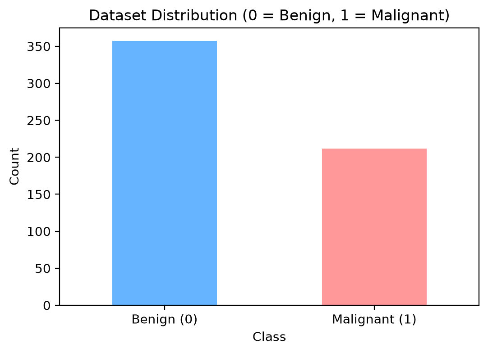
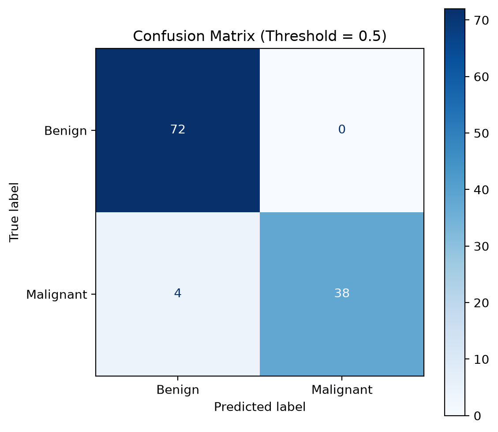
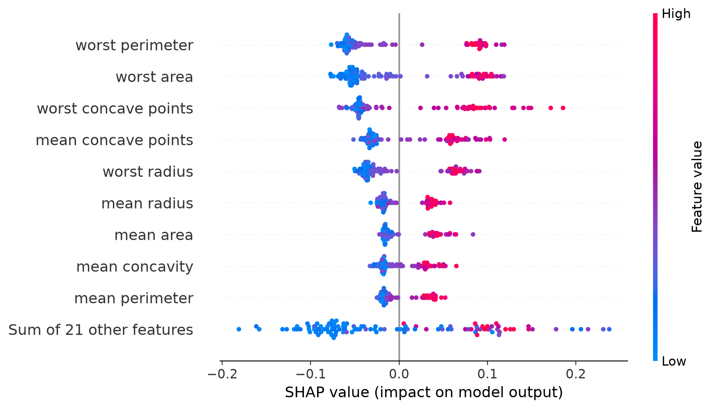
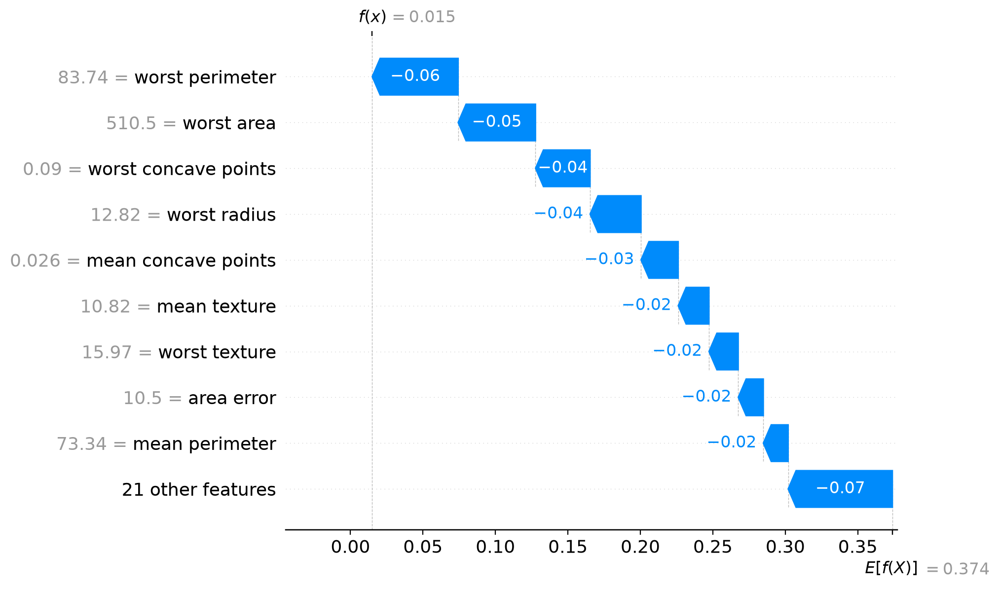
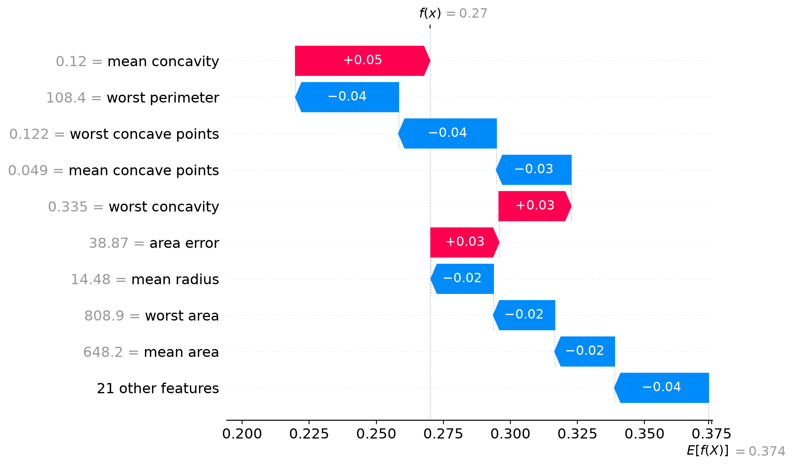
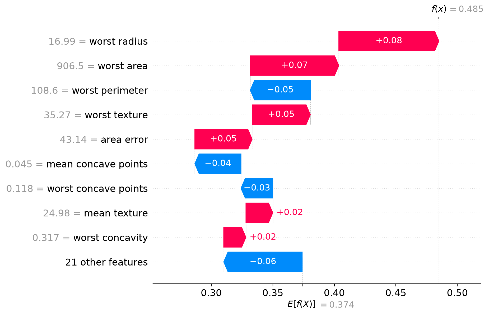
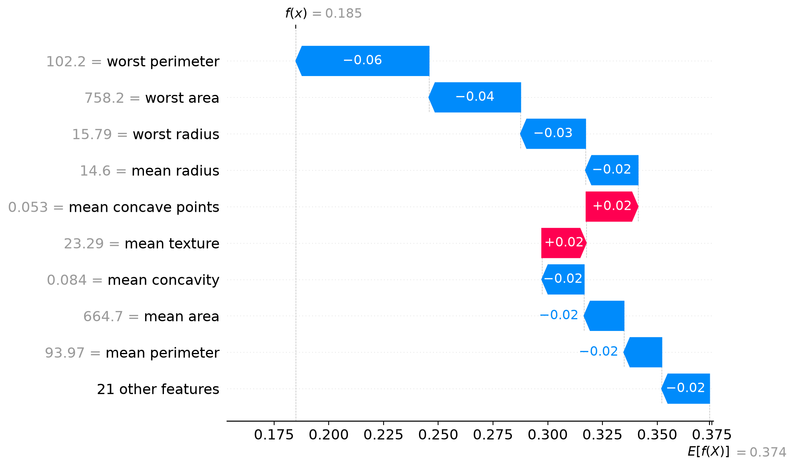
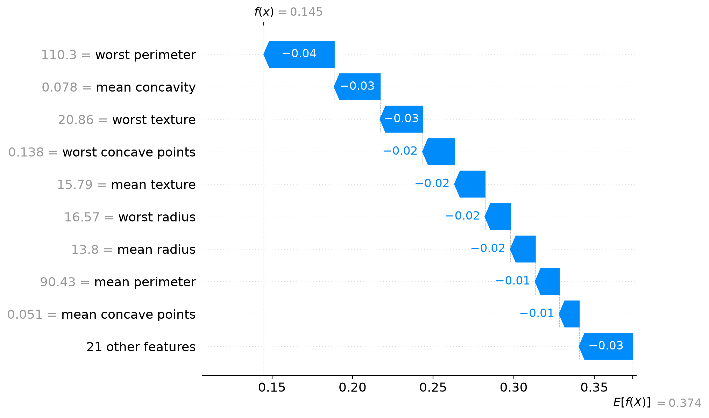
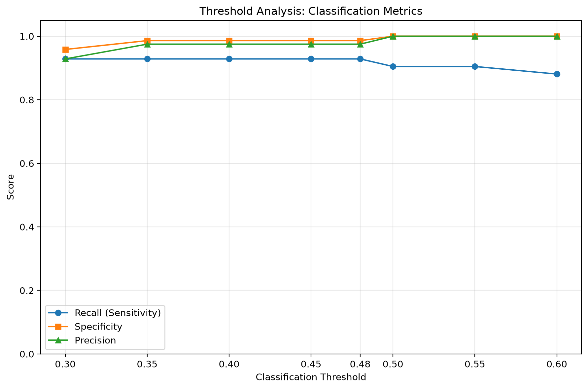
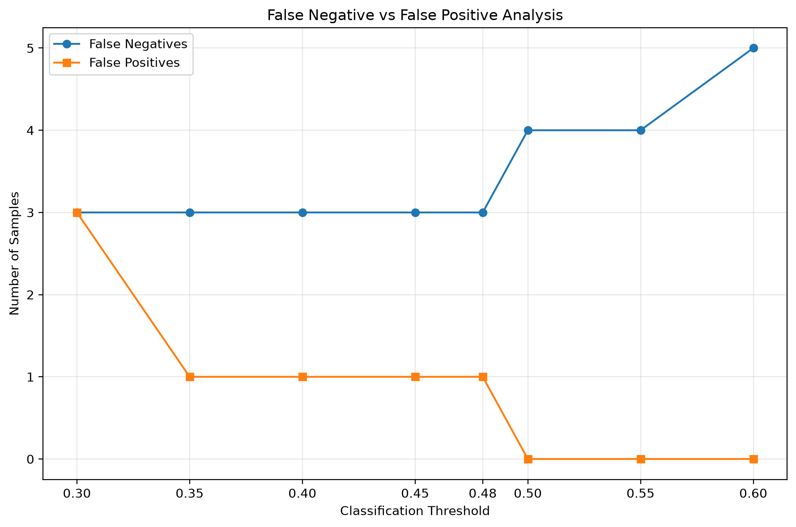

# MedXAI-Breast

## Explainable Breast Cancer Classification with Machine Learning

MedXAI-Breast is an educational and experimental research project exploring breast cancer classification with machine learning and post-hoc explainability. The current baseline uses the Wisconsin Diagnostic Breast Cancer (WDBC) dataset, a Random Forest classifier, and SHAP explanations.

> **Research use only.** This project is not a clinically validated diagnostic system. Its predictions and explanations must not be used for medical diagnosis or clinical decision-making.

## Research status

| Experiment | Description | Status |
|---|---|---|
| Exp01 | Random Forest baseline and SHAP explanations | Completed |
| Exp02 | False negative analysis | Completed |
| Exp02.1 | Exploratory classification threshold analysis | Completed |
| Exp03 | SHAP and LIME comparison | Planned |
| Exp04 | Random Forest, MLP, and KAN comparison | Planned |
| Exp05 | Comprehensive medical XAI evaluation | Planned |

Exp02 analysis outputs are present, but `reports/exp02_false_negative_report.md` is currently empty and has no written report content.

## Dataset and baseline configuration

The dataset is loaded from `sklearn.datasets.load_breast_cancer`; it is not redistributed in this repository. It contains 569 samples and 30 numeric features. Labels are recoded so that benign is class 0 and malignant is class 1. The baseline uses a stratified 80/20 train-test split with `random_state=42` and a `RandomForestClassifier` with 200 estimators, `random_state=42`, and `n_jobs=-1`.

### Dataset distribution



### Exp01 baseline results

At the default classification threshold of 0.50, the held-out test set results are:

| Metric | Result |
|---|---:|
| Accuracy | 0.9649 |
| Malignant precision | 1.0000 |
| Malignant recall | 0.9048 |
| Malignant F1-score | 0.9500 |
| ROC-AUC | 0.9942 |
| Confusion matrix (benign, malignant order) | `[[72, 0], [4, 38]]` |

The model correctly classified 110 of 114 test samples. Four malignant test samples were classified as benign.



### SHAP explanations

The beeswarm plot summarizes feature contributions across the test set. The waterfall plot explains one selected test sample. These plots explain the model's outputs; they do not establish biological causality or clinical relevance.





## Exp02 — False negative analysis

The original analysis at threshold 0.50 contains four false negative explanations. The sample identifiers in the filenames are test-set indices.








The separate Exp02 analysis uses threshold 0.40. It leaves three false negatives, with test-set indices 16, 24, and 42. These remaining false negatives are saved separately and do not replace the four original threshold 0.50 explanations.




## Exp02.1 — Exploratory threshold analysis

Eight classification thresholds from 0.30 to 0.60 were evaluated on the same held-out split. Selected comparisons are:

| Metric | Threshold 0.50 | Threshold 0.40 |
|---|---:|---:|
| Accuracy | 0.9649 | 0.9649 |
| Malignant precision | 1.0000 | 0.9750 |
| Malignant recall | 0.9048 | 0.9286 |
| Specificity | 1.0000 | 0.9861 |
| F1-score | 0.9500 | 0.9512 |
| False negatives | 4 | 3 |
| False positives | 0 | 1 |

At threshold 0.40, false negatives decrease from four to three while false positives increase from zero to one; accuracy remains 96.49%. This is an exploratory analysis on one test split. It does not identify an independently validated or clinically optimal threshold.





The complete tabular results are available in [`threshold_metrics.csv`](experiments/exp02_false_negative/results/threshold_metrics.csv).

## Project structure

```text
medxai-breast-cancer/
├── README.md
├── requirements.txt
├── data/                                  # Empty; WDBC is loaded via scikit-learn
├── experiments/
│   ├── exp01_baseline/
│   │   ├── main.py
│   │   └── results/
│   │       ├── dataset_distribution.png
│   │       ├── confusion_matrix.png
│   │       ├── shap_beeswarm.png
│   │       ├── shap_waterfall.png
│   │       ├── false_negative_16.png
│   │       ├── false_negative_24.png
│   │       ├── false_negative_27.png
│   │       └── false_negative_42.png
│   └── exp02_false_negative/
│       ├── false_negative_analysis.py
│       ├── threshold_analysis.py
│       └── results/
│           ├── false_negative_16.png
│           ├── false_negative_24.png
│           ├── false_negative_42.png
│           ├── threshold_metrics.csv
│           ├── threshold_metrics.png
│           └── fn_fp_comparison.png
└── reports/
    ├── exp01_baseline_report.md          # Written report
    ├── exp02_false_negative_report.md    # Currently empty
    ├── exp03_shap_lime_report.md         # Currently empty
    ├── exp04_model_comparison_report.md  # Currently empty
    └── exp05_comprehensive_evaluation.md # Currently empty
```

## Environment setup

Create and activate a virtual environment, then install the pinned dependencies:

```powershell
python -m venv .venv
.venv\Scripts\Activate.ps1
python -m pip install -r requirements.txt
```

## Running experiments

Run the scripts from the project root. Results are saved next to each experiment script, regardless of the current working directory.

```powershell
python experiments/exp01_baseline/main.py
python experiments/exp02_false_negative/false_negative_analysis.py
python experiments/exp02_false_negative/threshold_analysis.py
```

Exp01 regenerates its dataset distribution, confusion matrix, SHAP plots, and four default-threshold false negative plots. Exp02 false negative analysis generates the three remaining false negative plots at threshold 0.40. Threshold analysis regenerates `threshold_metrics.csv`, `threshold_metrics.png`, and `fn_fp_comparison.png`.

## Evaluation metrics

Malignant is the positive class. Accuracy measures overall correctness; precision and recall measure the correctness and coverage of malignant predictions; specificity measures the fraction of benign samples correctly identified; F1 is the harmonic mean of precision and recall; ROC-AUC measures ranking discrimination across thresholds.

## Limitations and scope

- Evaluation uses one public benchmark dataset and one stratified train-test split.
- Results do not establish generalization to independent clinical datasets.
- SHAP values explain model behavior and do not establish biological causality.
- Threshold comparisons are exploratory and require independent validation before any clinical interpretation.
- No clinical validation or prospective evaluation has been performed.

## References

1. Lundberg, S. M., & Lee, S. I. (2017). *A Unified Approach to Interpreting Model Predictions*. NeurIPS.
2. Breiman, L. (2001). *Random Forests*. Machine Learning, 45, 5–32.
3. Ribeiro, M. T., Singh, S., & Guestrin, C. (2016). *"Why Should I Trust You?": Explaining the Predictions of Any Classifier*. KDD.
4. [Scikit-learn: Breast Cancer Wisconsin (Diagnostic) dataset](https://scikit-learn.org/stable/modules/generated/sklearn.datasets.load_breast_cancer.html).
5. [SHAP documentation](https://shap.readthedocs.io/).
