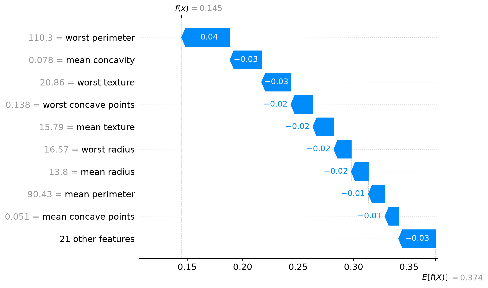
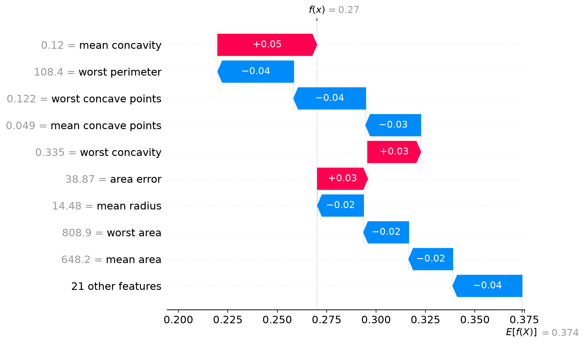
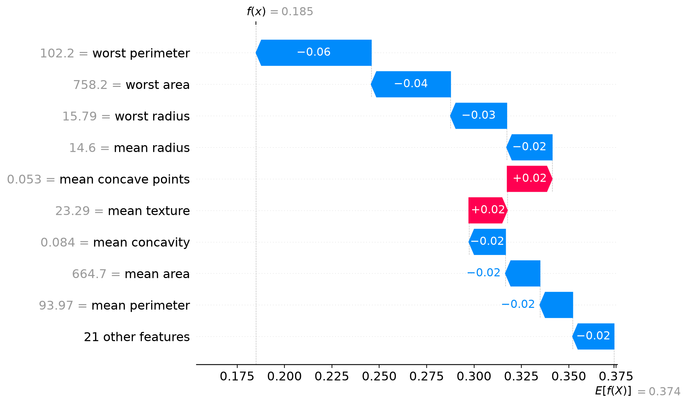
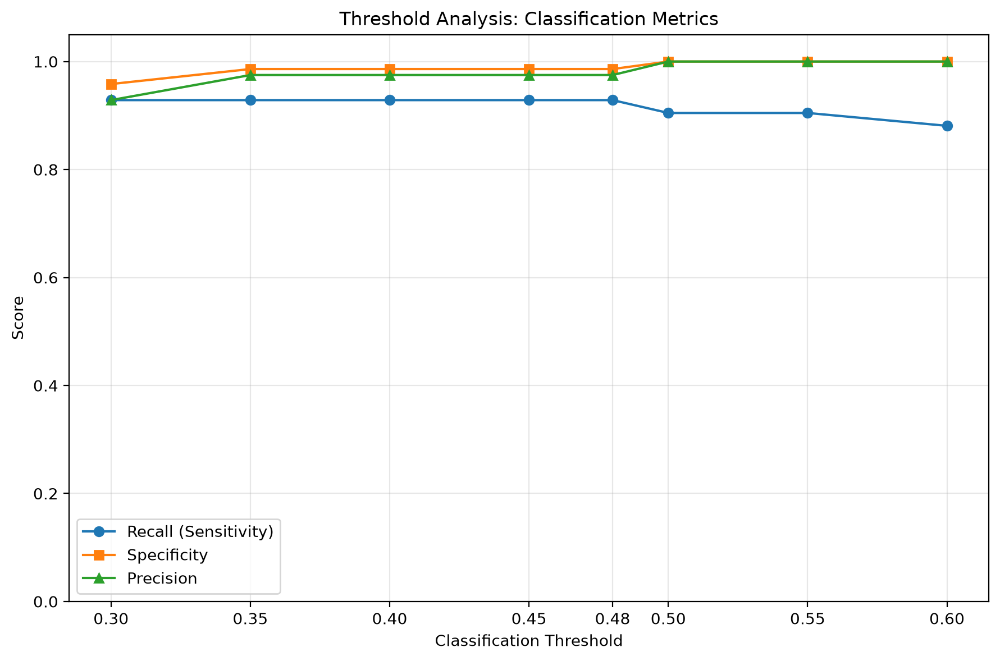
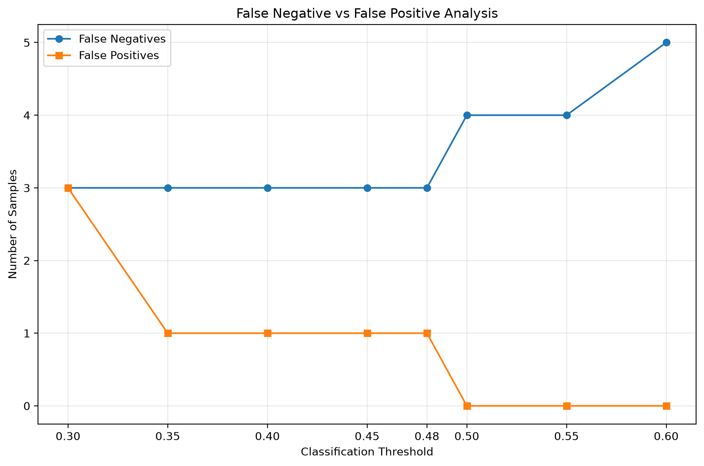

# Experiment 02 — False Negative Analysis and Threshold Evaluation

**Project:** MedXAI-Breast  
**Research Topic:** Explainable Breast Cancer Classification Using Random Forest and SHAP  
**Dataset:** Wisconsin Diagnostic Breast Cancer (WDBC)  
**Model:** Random Forest Classifier  
**Explainability Method:** SHAP TreeExplainer

---

## 1. Introduction

In a breast cancer classification task, a false negative occurs when a malignant sample is classified as benign. Such errors warrant focused analysis because they can be obscured by a strong overall accuracy score. Experiment 02 investigates the baseline model's false negatives and evaluates how changing its probability threshold affects malignant-class detection and benign-class errors.

The experiment has two related parts:

1. Apply a threshold of 0.40 and generate local SHAP explanations for the malignant test samples that remain classified as benign.
2. Compare performance at eight thresholds from 0.30 to 0.60 on the same held-out split.

The threshold comparison is exploratory and uses the existing test set. It is not a clinical threshold selection study.

## 2. Dataset and Experimental Setup

The experiment uses the WDBC dataset loaded through `sklearn.datasets.load_breast_cancer`. It contains 569 samples with 30 numeric features. The original target is recoded so that benign is class 0 and malignant is class 1; malignant is therefore the positive class in the metrics below.

The data are divided using stratified sampling, with 80% for training and 20% for testing (`random_state=42`). The model is a `RandomForestClassifier` with 200 estimators, `random_state=42`, and `n_jobs=-1`, matching the baseline configuration. The model is fit on the training subset, and threshold comparisons are made using its predicted malignant probabilities on the held-out test subset. The test set contains 72 benign and 42 malignant samples.

At the baseline threshold of 0.50, the confusion matrix (actual rows and predicted columns, ordered benign then malignant) is:

| Actual / Predicted | Benign | Malignant |
|---|---:|---:|
| Benign | 72 | 0 |
| Malignant | 4 | 38 |

Thus, the baseline has four false negatives and no false positives on this split.

## 3. Threshold 0.40 False Negative Analysis

For the focused case analysis, a test sample is classified as malignant when its predicted malignant probability is at least 0.40. This lower threshold flags more samples as malignant than the 0.50 baseline. At 0.40, three malignant samples remain false negatives: test-set indices 16, 24, and 42. Their local explanations were generated with SHAP TreeExplainer for the malignant-class output.

### Figure 1 — Remaining False Negative, Test Index 16

*Figure 1. SHAP waterfall explanation for test index 16, a malignant sample classified as benign at threshold 0.40.*

### Figure 2 — Remaining False Negative, Test Index 24

*Figure 2. SHAP waterfall explanation for test index 24, a malignant sample classified as benign at threshold 0.40.*

### Figure 3 — Remaining False Negative, Test Index 42

*Figure 3. SHAP waterfall explanation for test index 42, a malignant sample classified as benign at threshold 0.40.*

Each waterfall plot decomposes the model output for one sample into a baseline output and feature contributions. These visualizations can help inspect how the model arrived at its prediction, but they do not establish why a sample is malignant, identify causal factors, or provide a clinical assessment. The test indices are positions in the held-out subset, not patient identifiers.

## 4. Threshold Comparison Results

Eight thresholds were evaluated: 0.30, 0.35, 0.40, 0.45, 0.48, 0.50, 0.55, and 0.60. Accuracy, malignant precision, malignant recall (sensitivity), specificity, F1-score, false negative rate (FNR), ROC-AUC, and confusion-matrix counts were recorded. The full results are provided in `experiments/exp02_false_negative/results/threshold_metrics.csv`.

**Table 1. Selected threshold results on the held-out test set**

| Threshold | Accuracy | Malignant precision | Malignant recall | Specificity | F1-score | TN | FP | FN | TP |
|---:|---:|---:|---:|---:|---:|---:|---:|---:|---:|
| 0.30 | 0.9474 | 0.9286 | 0.9286 | 0.9583 | 0.9286 | 69 | 3 | 3 | 39 |
| 0.35 | 0.9649 | 0.9750 | 0.9286 | 0.9861 | 0.9512 | 71 | 1 | 3 | 39 |
| 0.40 | 0.9649 | 0.9750 | 0.9286 | 0.9861 | 0.9512 | 71 | 1 | 3 | 39 |
| 0.45 | 0.9649 | 0.9750 | 0.9286 | 0.9861 | 0.9512 | 71 | 1 | 3 | 39 |
| 0.48 | 0.9649 | 0.9750 | 0.9286 | 0.9861 | 0.9512 | 71 | 1 | 3 | 39 |
| 0.50 | 0.9649 | 1.0000 | 0.9048 | 1.0000 | 0.9500 | 72 | 0 | 4 | 38 |
| 0.55 | 0.9649 | 1.0000 | 0.9048 | 1.0000 | 0.9500 | 72 | 0 | 4 | 38 |
| 0.60 | 0.9561 | 1.0000 | 0.8810 | 1.0000 | 0.9367 | 72 | 0 | 5 | 37 |

The ROC-AUC was 0.9942 at every threshold because it is computed from the probability scores and does not change when only the decision cutoff changes.

### Figure 4 — Classification Metrics Across Thresholds

*Figure 4. Malignant precision and recall, and specificity, across the evaluated thresholds.*

### Figure 5 — False Negatives and False Positives Across Thresholds

*Figure 5. False negative and false positive counts across the evaluated thresholds.*

Compared with 0.50, thresholds from 0.35 through 0.48 reduce false negatives from four to three while adding one false positive. Accuracy remains 96.49%; malignant recall increases from 0.9048 to 0.9286, while specificity decreases from 1.0000 to 0.9861. At 0.30, the same three false negatives are observed but false positives increase to three, reducing accuracy to 94.74%. At 0.60, false negatives increase to five, with no false positives, and accuracy falls to 95.61%.

## 5. Discussion

The results show the expected trade-off on this test split: lowering the decision threshold from 0.50 to 0.35–0.48 identifies one additional malignant sample, at the cost of one benign sample being flagged as malignant. The 0.40 setting used for the local false negative analysis therefore reduces the false negative count from four to three, but does not eliminate false negatives.

Thresholds 0.35, 0.40, 0.45, and 0.48 produce identical classifications in this sample. This reflects the distribution of the model's predicted probabilities around the tested cutoffs; it does not imply that these thresholds are interchangeable on other data. Likewise, the unchanged ROC-AUC is expected because AUC evaluates ranking across cutoffs, whereas accuracy, precision, recall, specificity, and confusion-matrix counts depend on the selected cutoff.

The SHAP waterfall plots provide case-level views of the model's malignant-class output for the remaining false negatives. They can support error inspection, but they do not by themselves explain the clinical cause of a diagnosis or show that the model will behave similarly on independent cases.

## 6. Limitations

1. **Single split:** Threshold comparisons use one stratified train-test split with 114 test samples. Counts and metric differences may change on another split.
2. **Exploratory threshold evaluation:** Thresholds were compared on the same held-out set used for reporting. These results do not establish a threshold for deployment; independent validation would be needed for that purpose.
3. **Benchmark data:** WDBC is a public benchmark and does not represent the full range of clinical populations, acquisition settings, or sources of variation.
4. **Explanation scope:** SHAP attributes model output to input features. It does not establish causality, biological mechanism, or clinical relevance.
5. **No clinical validation:** This educational experiment is not a clinically validated diagnostic system and must not be used for medical decision-making.

## 7. Conclusion

Experiment 02 examined the baseline Random Forest's false negatives and evaluated classification thresholds on the held-out WDBC test set. At threshold 0.40, false negatives decreased from four to three while one false positive was introduced; accuracy remained 96.49%, malignant recall rose from 0.9048 to 0.9286, and specificity changed from 1.0000 to 0.9861. SHAP waterfall plots were generated for the three remaining false negatives.

These findings illustrate how threshold choice changes the balance between malignant-case detection and false alarms on this particular split. They are exploratory and require independent validation before any broader or clinical interpretation.

---

## References

1. Lundberg, S. M., & Lee, S. I. (2017). A Unified Approach to Interpreting Model Predictions. *Advances in Neural Information Processing Systems (NeurIPS)*.
2. Breiman, L. (2001). Random Forests. *Machine Learning*, 45, 5–32.
3. Scikit-learn Developers. [Breast Cancer Wisconsin (Diagnostic) dataset](https://scikit-learn.org/stable/modules/generated/sklearn.datasets.load_breast_cancer.html).
4. SHAP Developers. [SHAP documentation](https://shap.readthedocs.io/).
