# Experiment 03 — Comparative Analysis of SHAP and LIME

**Project:** MedXAI-Breast  
**Dataset:** Wisconsin Diagnostic Breast Cancer (WDBC)  
**Model:** Random Forest Classifier  
**Explainability methods:** SHAP TreeExplainer and LIME Tabular Explainer  
**Status:** Exp03.1–Exp03.3 implemented and executed

---

## 1. Research Objective

This experiment compares SHAP and LIME explanations for the same breast cancer classifier. It addresses three questions:

1. Do SHAP and LIME identify similar globally important features?
2. How consistent are their feature rankings and contribution directions for the same test samples?
3. How do their explanations compare for malignant samples classified as benign (false negatives, FNs)?

The experiment evaluates feature rankings and method-specific contribution directions. SHAP values and LIME coefficients have different definitions and scales, so their raw magnitudes are not compared directly.

## 2. Experimental Setup

### 2.1 Dataset, labels, and split

The WDBC dataset was loaded from `sklearn.datasets.load_breast_cancer`. It contains 569 samples and 30 numeric features. Labels follow the existing project encoding:

```python
y = (dataset.target == 0).astype(int)
```

Thus class 0 is benign and class 1 is malignant. A stratified 80/20 train-test split with `random_state=42` yielded 455 training samples and 114 test samples.

### 2.2 Shared model and baseline validation

One `RandomForestClassifier` was fitted and shared by both explainers and all three sub-experiments. Its parameters match Exp01/Exp02: `n_estimators=200`, `random_state=42`, and `n_jobs=-1`. Classification uses threshold 0.50 and malignant as the positive class.

| Metric | Exp03 result | Exp01 reference |
|---|---:|---:|
| Accuracy | 0.9649 | 0.9649 |
| Malignant precision | 1.0000 | 1.0000 |
| Malignant recall | 0.9048 | 0.9048 |
| Malignant F1-score | 0.9500 | 0.9500 |
| ROC-AUC | 0.9942 | 0.9942 |

Confusion matrix (actual rows and predicted columns; benign, malignant order) was `[[72, 0], [4, 38]]`. The four default-threshold FNs were test-set indices **16, 24, 27, and 42**, matching Exp01.

### 2.3 Reproducibility configuration

Python and NumPy random seeds were set to 42; the model and LIME explainer also use seed 42. LIME uses the full set of 30 original feature names, class names `Benign` and `Malignant` in class order `[0, 1]`, `feature_selection='none'`, `discretize_continuous=False`, and 5,000 perturbation samples per explanation. Explanations use the shared model's `predict_proba` through a feature-name-preserving wrapper.

The executed environment recorded SHAP 0.51.0, LIME 0.2.0.1, scikit-learn 1.9.1, NumPy 2.4.6, SciPy 1.17.1, pandas 3.1.1, and Matplotlib 3.11.2. These versions match the relevant pins in `requirements.txt`. Full run configuration and baseline metrics are stored in `experiments/exp03_shap_vs_lime/results/run_metadata.json`.

## 3. Methodology

### 3.1 Global feature importance

SHAP importance is the mean absolute class-1 SHAP value across all 114 test samples. LIME importance is the mean absolute class-1 local surrogate weight across the same 114 samples. Top-10 overlap is computed as the count of shared features. Spearman and Kendall correlations are calculated between the two complete 30-feature importance rankings.

### 3.2 Local explanations

The same test rows are explained by both methods: the TP nearest the 0.50 cutoff (index 3), the TN nearest below the cutoff (index 92), and all four FNs. For each sample, feature ranks are based on absolute contribution values within each method. Direction is recorded as the SHAP effect on class-1 model output and the sign of the LIME class-1 local surrogate coefficient.

### 3.3 False negative comparisons

At threshold 0.50, each of the four malignant test samples predicted benign receives a class-1 SHAP waterfall plot, a class-1 LIME local explanation plot, and a paired rank/direction plot. CSV rows retain per-feature rankings, method-specific signed contributions, direction agreement, Top-10 membership, and rank differences.

## 4. Results

### 4.1 Global comparison

The SHAP and LIME Top-10 lists shared **7 of 10 features**: `worst perimeter`, `worst area`, `worst concave points`, `mean concave points`, `worst radius`, `mean area`, and `area error`.

| Rank | SHAP feature | LIME feature |
|---:|---|---|
| 1 | worst perimeter | worst area |
| 2 | worst area | worst perimeter |
| 3 | worst concave points | worst concave points |
| 4 | mean concave points | worst radius |
| 5 | worst radius | area error |
| 6 | mean radius | mean texture |
| 7 | mean area | mean concave points |
| 8 | mean concavity | worst texture |
| 9 | mean perimeter | mean area |
| 10 | area error | worst concavity |

Across all 30 features, the Spearman rank correlation was **0.8883** and Kendall rank correlation was **0.7241**. In this run, the two methods therefore gave similar global importance rankings, while retaining differences in their ordering and in three of the Top-10 selections.

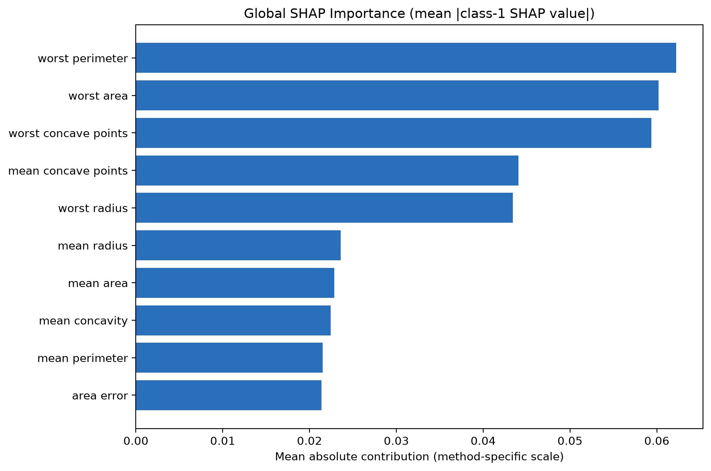

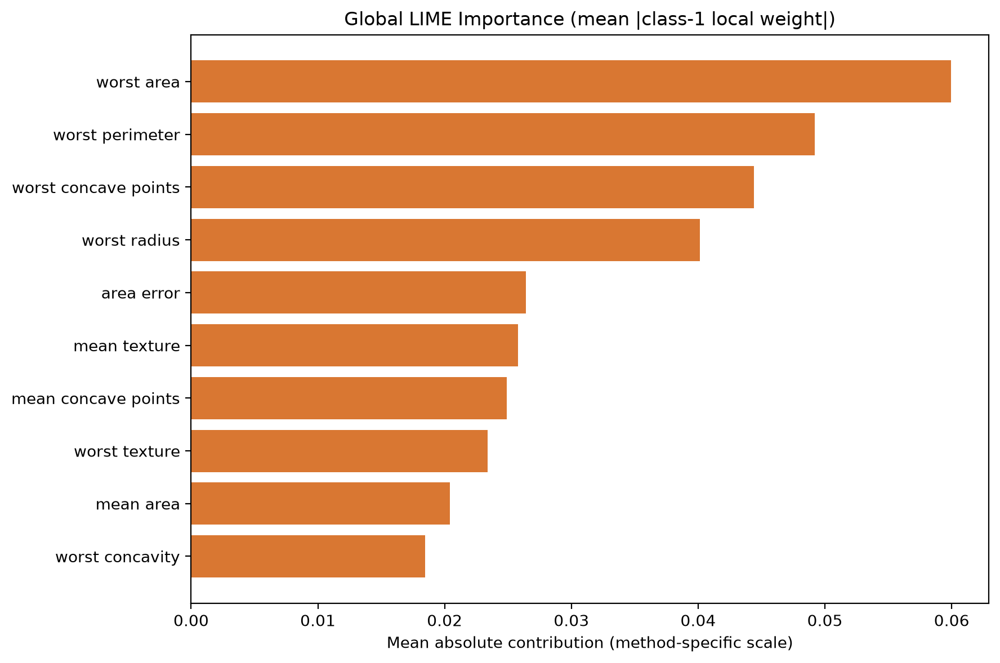

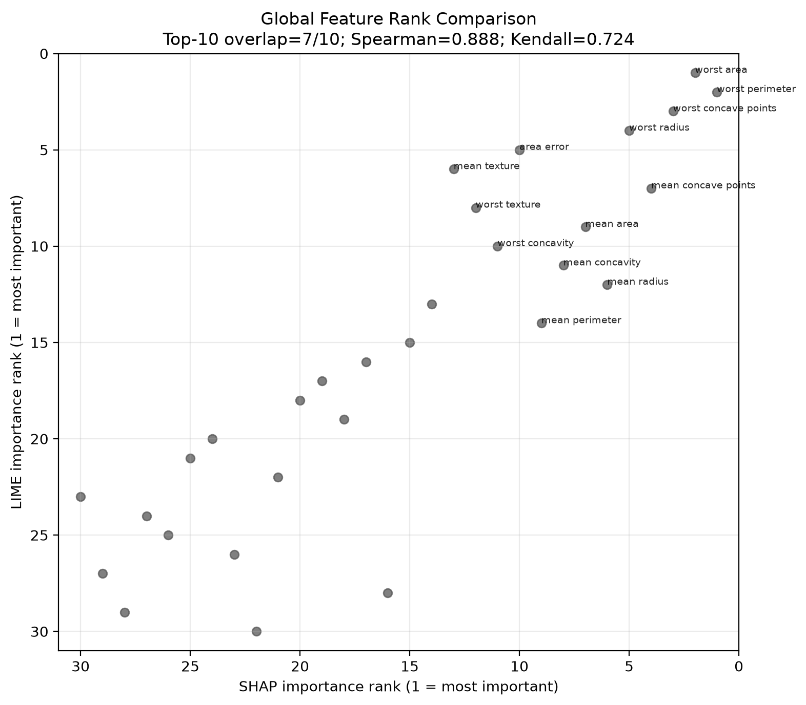

### 4.2 Local comparison

| Sample type | Test index | Malignant probability | Top-10 overlap | Spearman | Kendall | Direction agreement across 30 features |
|---|---:|---:|---:|---:|---:|---:|
| TP | 3 | 0.585 | 6/10 | 0.5257 | 0.3471 | 40.0% |
| TN | 92 | 0.480 | 6/10 | 0.6400 | 0.4529 | 50.0% |
| FN | 16 | 0.145 | 7/10 | 0.7402 | 0.5402 | 36.7% |
| FN | 24 | 0.270 | 8/10 | 0.7637 | 0.5540 | 50.0% |
| FN | 27 | 0.485 | 9/10 | 0.8870 | 0.7471 | 50.0% |
| FN | 42 | 0.185 | 7/10 | 0.7428 | 0.5356 | 26.7% |

Feature rankings showed moderate to strong agreement for the four FNs, with 7–9 shared Top-10 features. Direction agreement was lower, ranging from 26.7% to 50.0% across all 30 features. The FN ranking agreement was strongest for index 27, the FN closest to the classification threshold. This is an observed pattern for these samples, not evidence that explanation agreement generally depends on confidence.

The paired plots show feature ranks and signs separately; they do not compare contribution magnitudes across methods.

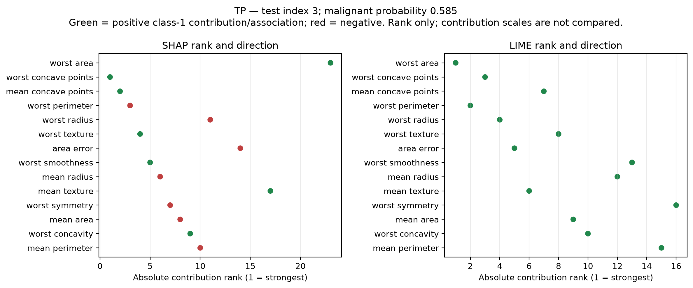

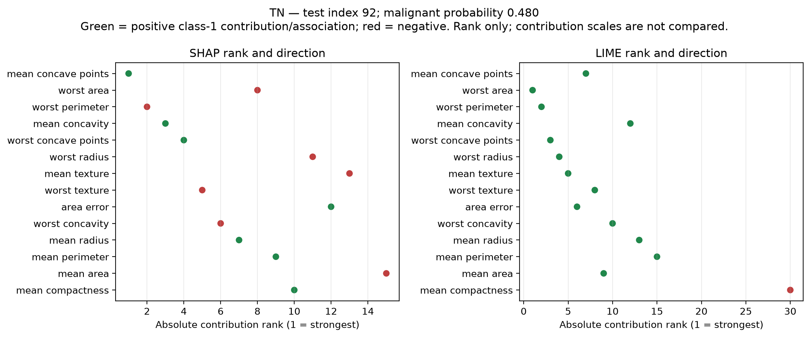

### 4.3 False negative comparison

| FN test index | Malignant probability | Shared Top-10 features | Spearman | Kendall | Direction agreement |
|---:|---:|---:|---:|---:|---:|
| 16 | 0.145 | 7/10 | 0.7402 | 0.5402 | 36.7% |
| 24 | 0.270 | 8/10 | 0.7637 | 0.5540 | 50.0% |
| 27 | 0.485 | 9/10 | 0.8870 | 0.7471 | 50.0% |
| 42 | 0.185 | 7/10 | 0.7428 | 0.5356 | 26.7% |

The average FN Top-10 overlap was 7.75 features. The mean Spearman correlation across the four cases was 0.7834; mean Kendall correlation was 0.5943. Shared high-ranking features commonly included worst perimeter, worst area, worst radius, worst concave points, mean concave points, and worst texture, but no feature was shared in the Top 10 for every FN.

Direction differences were notable. For example, all seven shared Top-10 features for index 16 had negative SHAP contributions but positive LIME coefficients. For index 27, several shared features (including worst radius, worst area, and worst texture) were positive under both methods, while worst perimeter and worst concave points had opposite signs. These signs refer to different explanation definitions: SHAP decomposes the model output for the sample; LIME fits a local surrogate around the sample. They should not be treated as directly interchangeable causal effects.

#### FN explanation figures

| Test index | SHAP waterfall | LIME local explanation | Paired rank comparison |
|---:|---|---|---|
| 16 | 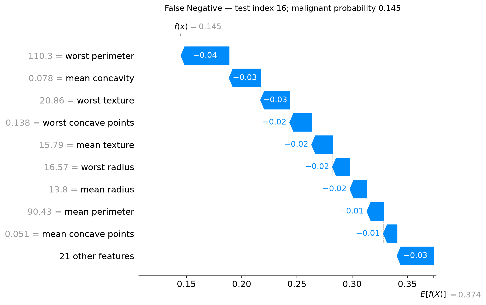 | 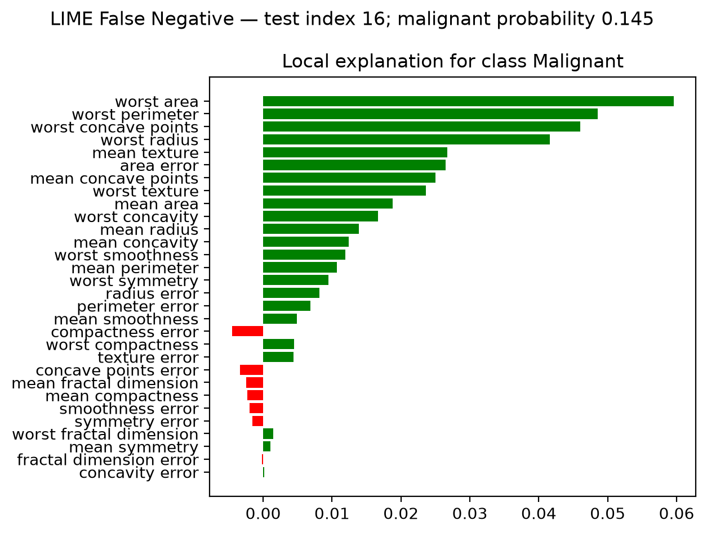 | 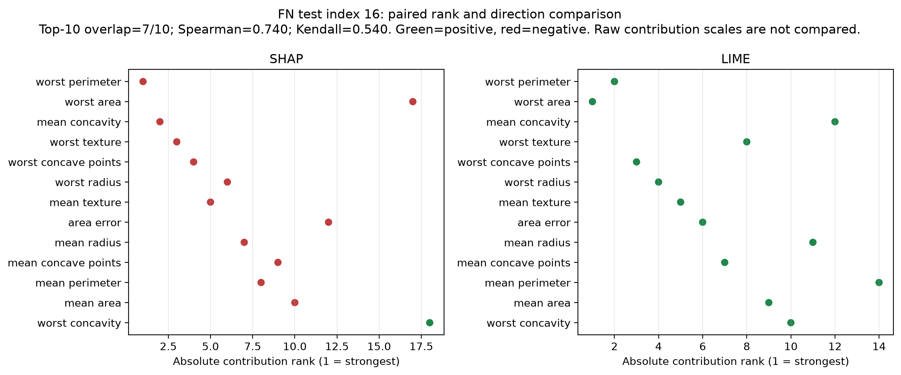 |
| 24 | 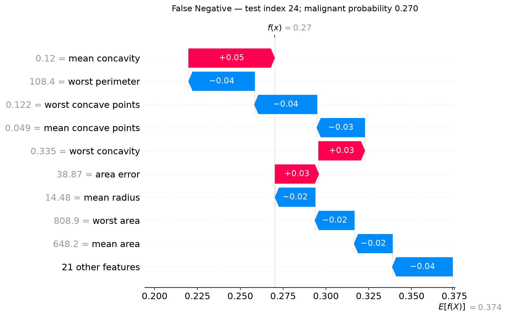 | 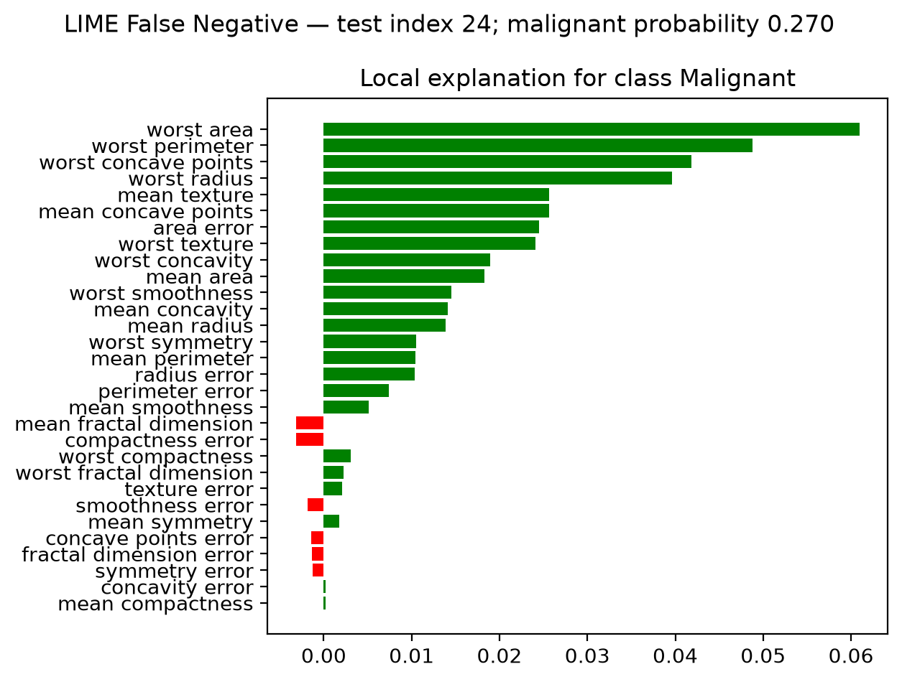 | 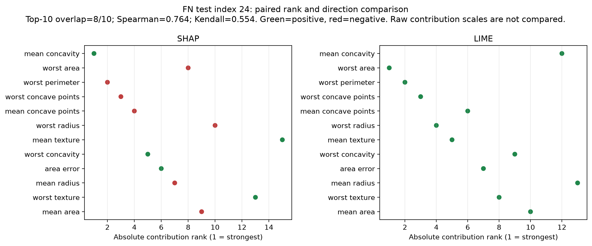 |
| 27 | 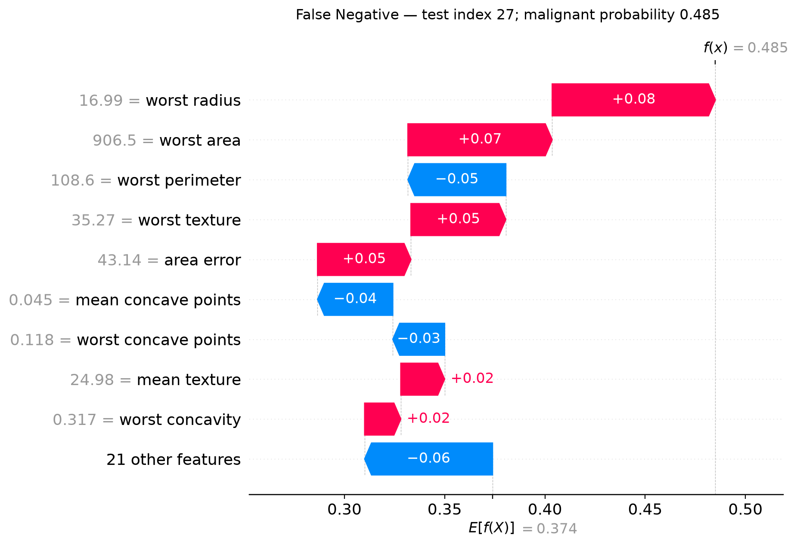 | 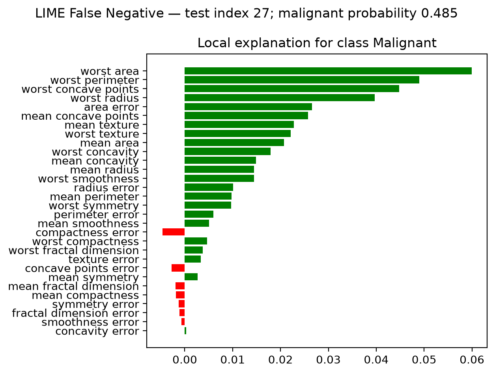 | 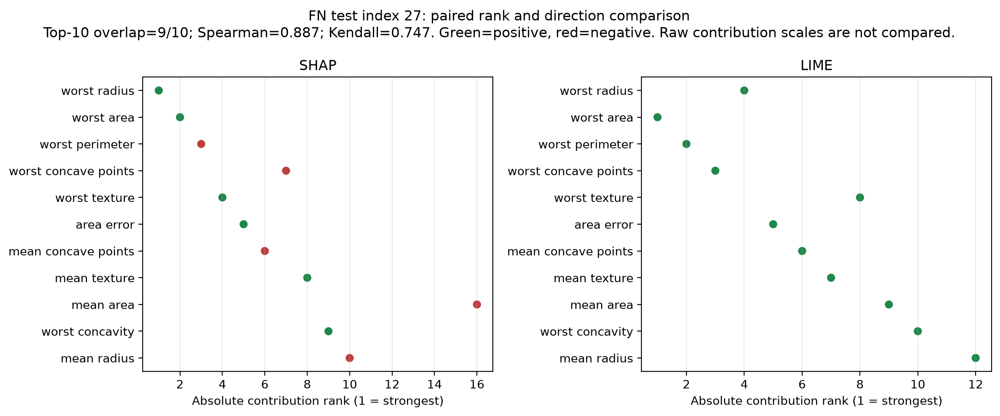 |
| 42 | 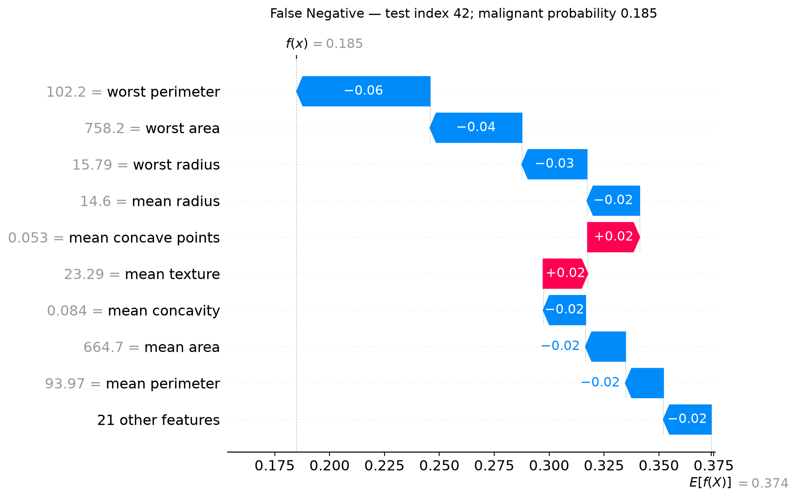 | 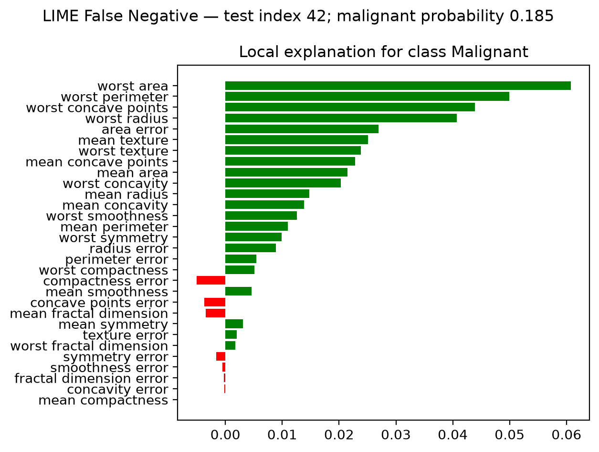 | 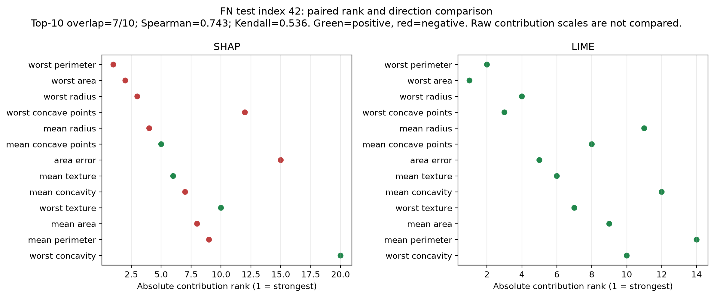 |

## 5. Comparative Analysis

For this fitted model and test split, SHAP and LIME broadly agreed on global feature importance: their Top-10 lists overlapped by seven features and their full rankings had high rank correlation. Agreement was less uniform locally. FN Top-10 lists still overlapped substantially, but signed directions often differed, including for some high-ranking features. The observed comparison therefore depends on whether agreement is defined by global ranking, local ranking, or direction.

The global SHAP and LIME scores summarize different quantities. SHAP uses mean absolute attribution for the model output; LIME averages local surrogate coefficient magnitudes over perturbation-based explanations. The rankings are useful for comparison within this experiment, but the coefficients do not represent a shared numeric scale.

## 6. Discussion

The experiment demonstrates that two post-hoc explainers can identify similar broad global patterns while giving different explanations for individual errors. For the four false negatives, feature rank correlations were positive and Top-10 overlap was relatively high, yet direction agreement across the 30 features was limited. This shows why a similarity conclusion based only on feature lists would omit an important part of local explanation behavior.

The results do not establish that one method is more correct. Both methods describe the fitted model through different attribution mechanisms. LIME approximates the model locally using perturbed samples; SHAP attributes model output according to its cooperative-game formulation. Any disagreement should be treated as a diagnostic observation about these explanation methods and the model, not as evidence about the biological cause of malignancy.

## 7. Limitations

1. The evaluation uses one benchmark dataset and one stratified train-test split; results may differ on independent data or another split.
2. LIME explanations depend on the perturbation procedure and chosen sample count (5,000); a different random seed or perturbation configuration may change local weights.
3. The global LIME ranking averages local surrogate weights over this particular test set and should not be interpreted as a model-intrinsic global attribution equivalent to SHAP.
4. Local direction agreement is based on SHAP output attributions and LIME surrogate coefficients, which have different definitions.
5. Test-set indices are row positions, not patient identifiers. This educational experiment is not a clinically validated diagnostic system and must not inform medical decisions.

## 8. Conclusion

On the evaluated WDBC test split, SHAP and LIME showed substantial agreement in global rankings (Top-10 overlap 7/10; Spearman 0.8883; Kendall 0.7241). For the four default-threshold FNs, the Top-10 overlap ranged from 7/10 to 9/10, while feature-direction agreement was 26.7%–50.0%. The results support a qualified conclusion: the methods often prioritized similar features, but local contribution directions could diverge. Further validation across samples, splits, and stability settings is needed before drawing broader conclusions.

## 9. References

1. Lundberg, S. M., & Lee, S. I. (2017). *A Unified Approach to Interpreting Model Predictions*. NeurIPS.
2. Ribeiro, M. T., Singh, S., & Guestrin, C. (2016). *"Why Should I Trust You?": Explaining the Predictions of Any Classifier*. KDD.
3. Scikit-learn Developers. [Breast Cancer Wisconsin (Diagnostic) dataset](https://scikit-learn.org/stable/modules/generated/sklearn.datasets.load_breast_cancer.html).
4. SHAP Developers. [SHAP documentation](https://shap.readthedocs.io/).
5. LIME Developers. [LIME repository and documentation](https://github.com/marcotcr/lime).
